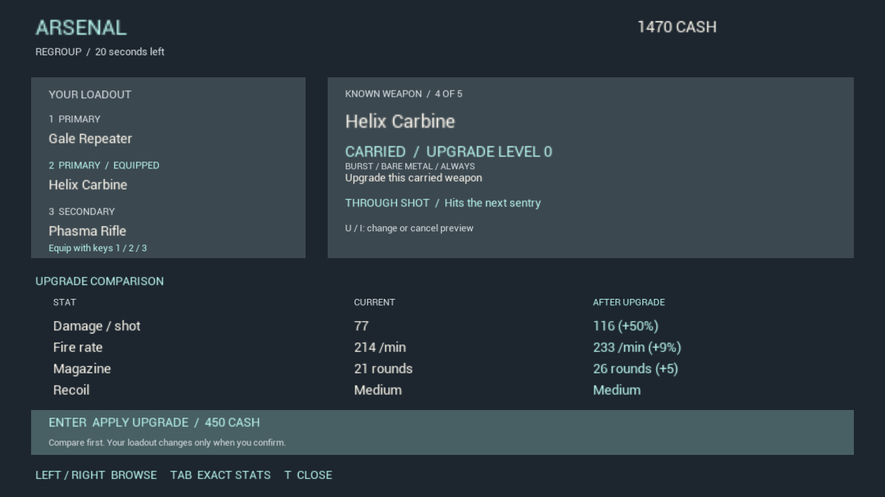

# VS44 — Readable arsenal and verified confirmations

The arsenal now has larger names and four core comparison rows, a distinct price/action area, contextual equip/buy/upgrade controls, and a full-page exact comparison. Empty-primary purchases show the real destination; owned guns show their carried slot and equipped state. Exact accuracy, DPS, recoil and current-party/solo enemy estimates remain available through Tab/L3. Existing game HUD, weapon balance, prices and rewards are unchanged.

Upgrade keys toggle previews off as well as on. Successful confirmation exits the preview, and changing the selection clears stale receipts. Current cash shortfalls and actual paid receipts are visible separately from the intended action.

A new actual-controller-binding test verifies Enter purchasing, insufficient-cash rejection, duplicate protection, preview cancellation, chosen upgrade confirmation, reroll-before-keep and free wildcard confirmation into the secondary slot. Its acquisition never calls PurchaseWeapon/UpgradeWeapon directly. It passes at 1280×720 and 800×600. All sixteen frames were visually inspected; the three existing weapon-switch/fire/ammo frames were also inspected and their test passes. [Test results](test-results.json), [visual review](visual-check.json).

Final Editor build and a fresh Windows Shipping Prototype build/cook/stage/archive pass. The package was not launched. Actual bindings are invoked by automation, not hardware keyboard input. Controlled cash, accelerated encounter clears and a slowed capture window do not establish natural economy, normal run length or human fun. An engine shader notice remains in the separate live-encounter loadout capture; the confirmation screens are clean in the inspected frames.

Current Source/Config/Content manifest: 561 inputs, with two modified production files and one new fixture. The runner hash is recorded separately. The baseline failed the two new preview UX requirements while its purchase/keep assertions passed; an initial format-string compile error was corrected. Only final runs establish current passes.

Keep the October 4 VS41 69% / 68.5 weighted low-confidence planning estimate. No new whole-game points; 75% and beta acceptance remain open. Next work is natural cash/weapon progression and combat pacing, followed by packaged friend co-op. Owner comprehension/fun and the future enemy attack rhythm remain open. This pass was self-reviewed, not independently reviewed by another agent. Source and records are local/unpublished.
