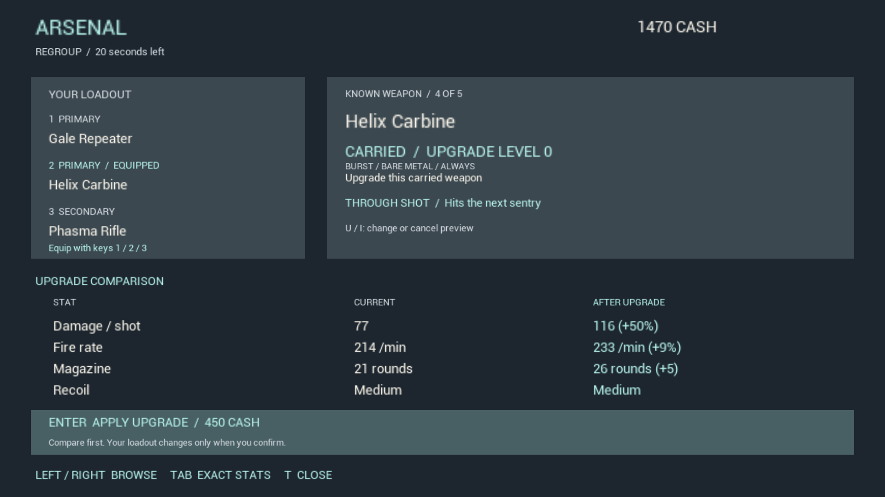

# VS45 — Owner resolution: 1080p

The owner plays at 1920×1080. This is now the primary UI validation target; the prior 1280×720 and 800×600 checks remain fallback coverage.

The existing arsenal confirmation fixture passes at actual 1920×1080. All eight rendered D3D12 offscreen screens were visually inspected: known purchase, cash rejection, purchase receipt, upgrade preview/details/receipt and wildcard comparison/keep. Text, columns, cash, slots, equip markers and prompts fit without overlap or clipping. [Results](test-results.json), [frames and hashes](visual-check.json).

All 561 game inputs and the fixture runner match VS44. No source, balance or display setting changed; no build/package repeated. VS44 build and loadout evidence retains its original date/scope. Controlled key-delegate automation, fixture cash, accelerated encounter clears and slowed capture windows do not establish physical input, natural pacing, human readability/fun or packaged co-op acceptance.

The October 4 VS41 estimate remains 69% (68.5 weighted, low confidence). No readiness credit or beta approval is added. Source and these records remain local/unpublished.
