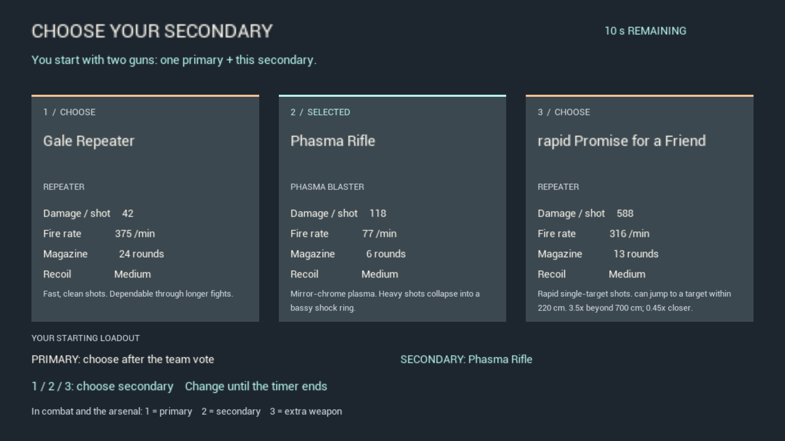

# VS46 — Deliver the current build and clarify the starting loadout

The owner’s Play-IRON-SUN batch was selecting an older complete package. VS43/44 packages had been archived elsewhere for tests, leaving the launcher’s default folder stale. The player-package comparison failed on the Shipping runtime hash before the fix. A fresh Shipping archive now lives under the default Saved/Packages folder; the unchanged batch selects it, and all five executable/content hashes match. [Diagnosis](diagnosis.json), [package hashes](package-artifacts.json).

Opening personal perks and weapon selection now use larger readable text. Perks separate the equipped slots, name/lock list and selected effect. Weapon cards show damage, fire rate, magazine, recoil and brief behavior. The menu explicitly says a run begins with one primary plus the selected secondary; primary selection follows the team vote. Reserved guns and unavailable wildcard primaries are labeled. Main combat layout and team-vote layout are unchanged; the combat weapon-key hint is updated; compact/portrait screens retain their fallback.

Normal timed startup passes for Phasma (default), Gale and wildcard secondaries. The extended fixture invokes actual T/1/2/3 and mouse-fire delegates: both starting guns show the correct name, can be equipped in the arsenal, and fire after closing it. Key 1 draws the primary; key 2 draws the secondary idempotently; key 3 draws the extra primary. The extra primary starts empty, and selecting that empty slot safely retains the current gun. Guns are earned through actual startup, with no direct acquisition or purchase fixture calls. Repeated key 2 stays on the secondary. The paid arsenal fixture separately confirms that 3 equips a newly purchased extra gun. Enemies are frozen and the player repositioned near the real arsenal after deployment for isolation.

All sixteen final 1080p frames were inspected. Shader-preparation notices remain in some deployment/arsenal frames. Builds, automation and package selection are verified; this package was not launched or played, and OS keyboard/gamepad, human readability/fun, natural balance and packaged friend co-op remain open. The new secondary-equip RPC compiled but was not exercised by a remote client this pass. [Tests](test-results.json), [visual review](visual-check.json).

Current inputs: 562, with eight modified files and one added opening HUD file. Keyboard equip now follows carried slots in combat/arsenal, and key 2 explicitly selects the secondary on the authority (including an owned reliable RPC) rather than toggling it. Damage, economy and gamepad mappings are unchanged. Keep VS41’s October 4 low-confidence 69% (68.5 weighted) planning estimate, with no new readiness credit or beta approval. Source and records are local/unpublished. For future owner builds, use the launcher’s default package folder and compare its selected artifacts against the recorded build before handing off.
